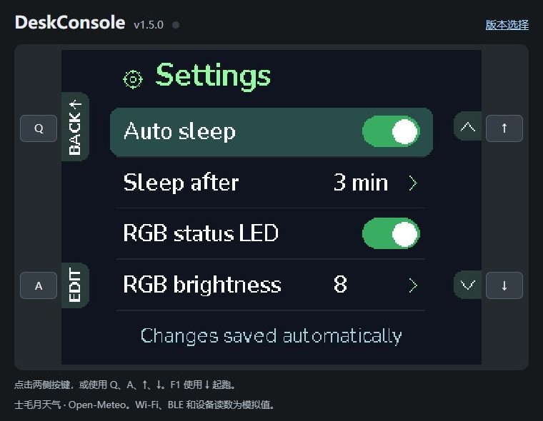
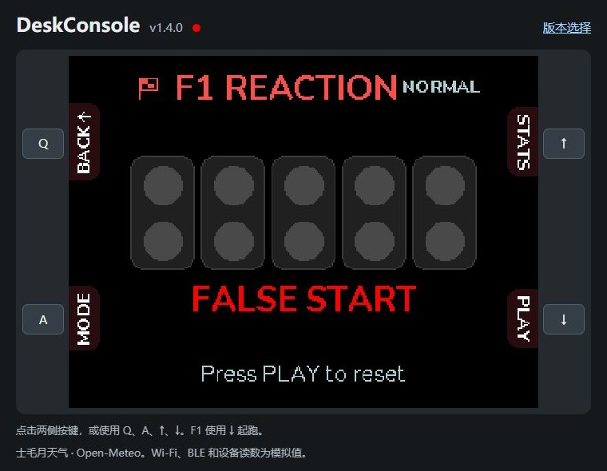
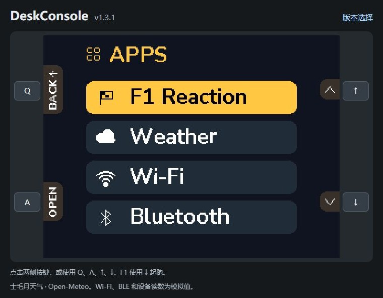
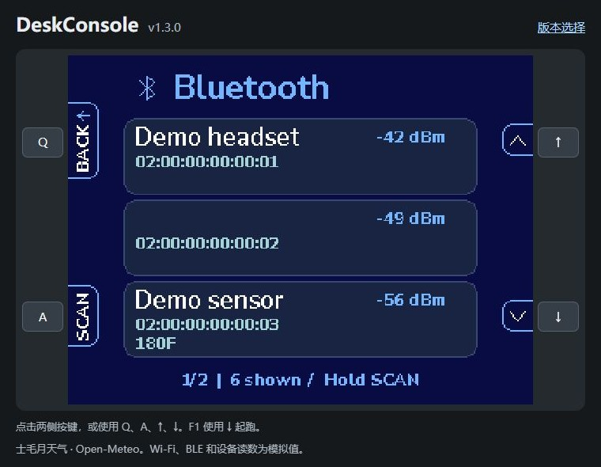
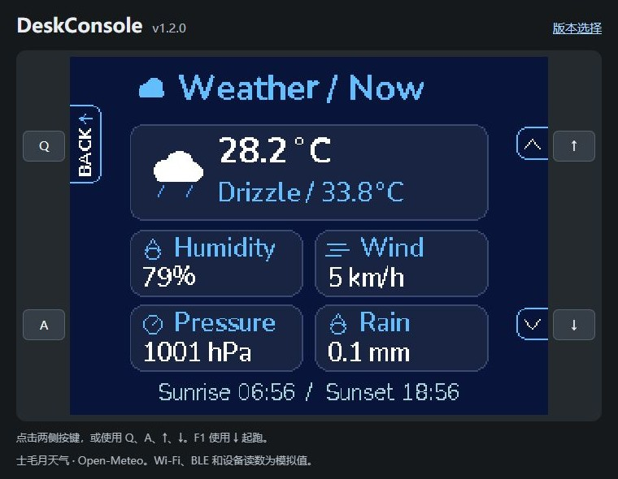
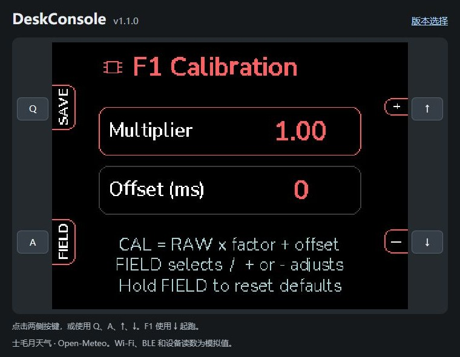
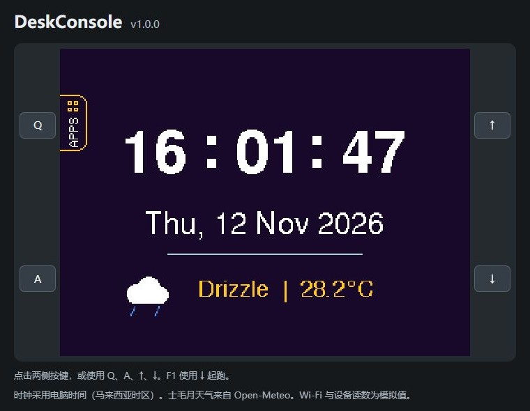

# Release history / 版本记录

Screenshots below were captured from the corresponding [live browser simulator](https://uim-g.github.io/ESP32-DeskConsole/).

下方截图均取自对应版本的[在线网页模拟器](https://uim-g.github.io/ESP32-DeskConsole/)。

## v1.5.0

- Add persistent Settings for auto sleep, idle duration, RGB enable, and brightness. 新增可记忆的自动休眠、时长、RGB 开关和亮度设置。
- Animate selection, toggle knobs, and rolling setting values. 设置选中框、拨钮和数值加入缓动动画。
- Draw Home before wireless setup, avoid clock polling waits, and report boot timing. 提前显示桌面，移除时钟绘制等待，增加启动耗时日志。

## v1.4.0

- Add GPIO48 onboard RGB cues for F1, Wi-Fi, BLE, and flash saves. 加入 GPIO48 板载 RGB 状态反馈。
- Include the Wokwi wiring reference and the display ground correction in both READMEs. 双语 README 加入 Wokwi 接线图和屏幕 GND 补接说明。

## v1.3.1

- Replace side-button outlines with a subtle theme-tinted fill and keep white labels and icons. 侧边按键提示改为低对比度主题色填充，文字和图标保持白色。

## v1.3.0

- Add on-demand BLE scanning, RSSI sorting, three-result pages, and unnamed-device filtering. 新增 BLE 扫描、信号排序、整页翻动和无名称过滤。
- Add circular App menu scrolling and long-press navigation. App 菜单双向循环滚动，支持长按连翻。
- Add device usage meters, firmware version, and a color-coded thermometer. 设备页显示内存和固件用量、版本号和彩色温度计。
- Extend idle light sleep to three minutes. 闲置轻度休眠延长到三分钟。

## v1.2.0

- 60-second idle light sleep with four-button wake. 60 秒无操作后轻睡，四个按键均可唤醒。
- F1 fireworks for a new personal best. F1 刷新个人最快原始成绩时播放烟花。
- Sunrise and sunset on the current weather page, data time on the forecast page, and a clearer Free PSRAM label. 调整天气页信息位置和剩余 PSRAM 标注。

## v1.1.0

- Nunito typography, animated rounded launcher highlights, and clipped edge labels. Nunito 字体、圆角高亮缓动和侧边标签动画。
- Weather, Wi-Fi, and Device pages use icon cards. 天气、Wi-Fi 和设备页改用图标卡片。
- F1 RAW/CAL timing, persistent calibration, statistics reset, and local mode updates. F1 增加原始和修正成绩、补偿设置、统计归零及模式局部刷新。
- Event-based serial diagnostics, UI concept sheet, and expanded bilingual setup instructions. 事件式串口日志、UI 示意图和详细双语文档。

## v1.0.0

- Home screen with local time, date, and current weather. 桌面显示本地时间、日期和当前天气。
- App launcher for F1 Reaction, Weather, Wi-Fi, and Device. App 菜单包含 F1、天气、网络和设备诊断。
- Persistent F1 statistics and Normal / Debug modes. 闪存保存 F1 统计，支持普通和调试模式。
- Animated edge labels, per-app colors, and weather icons driven by current conditions. 边缘标签动画、独立主题色和随天气变化的图标。

