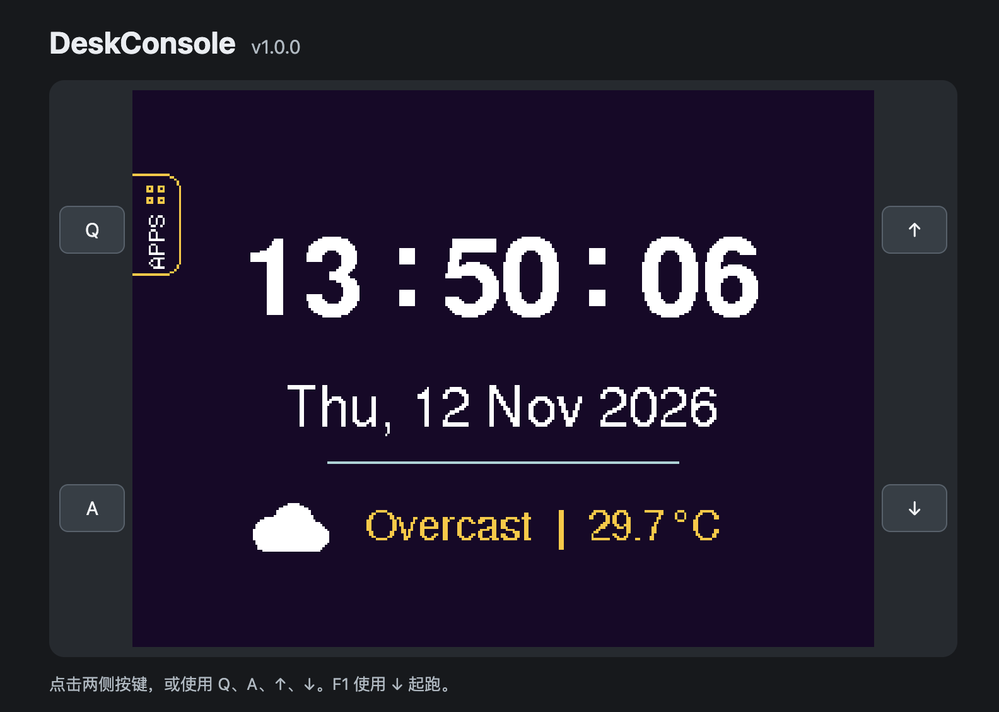
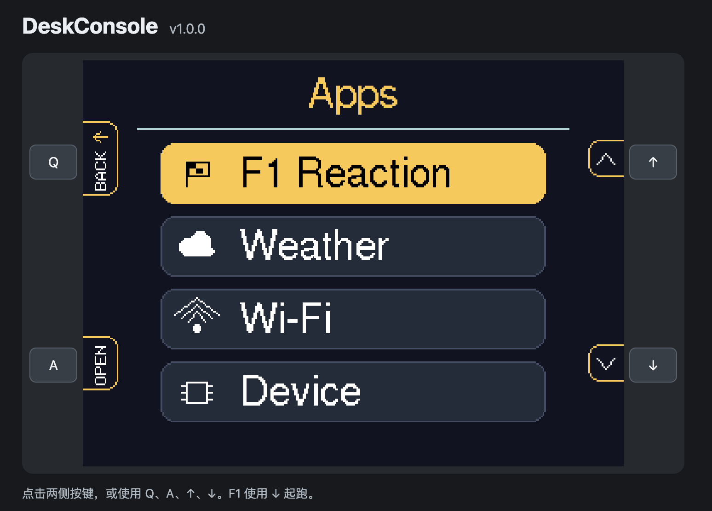
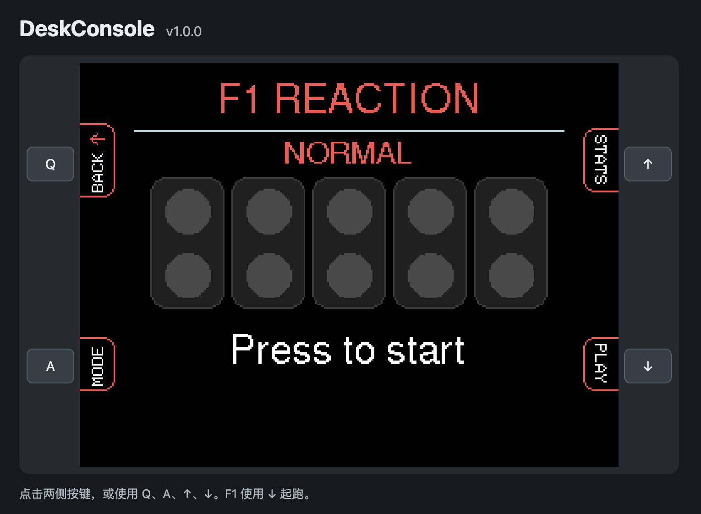
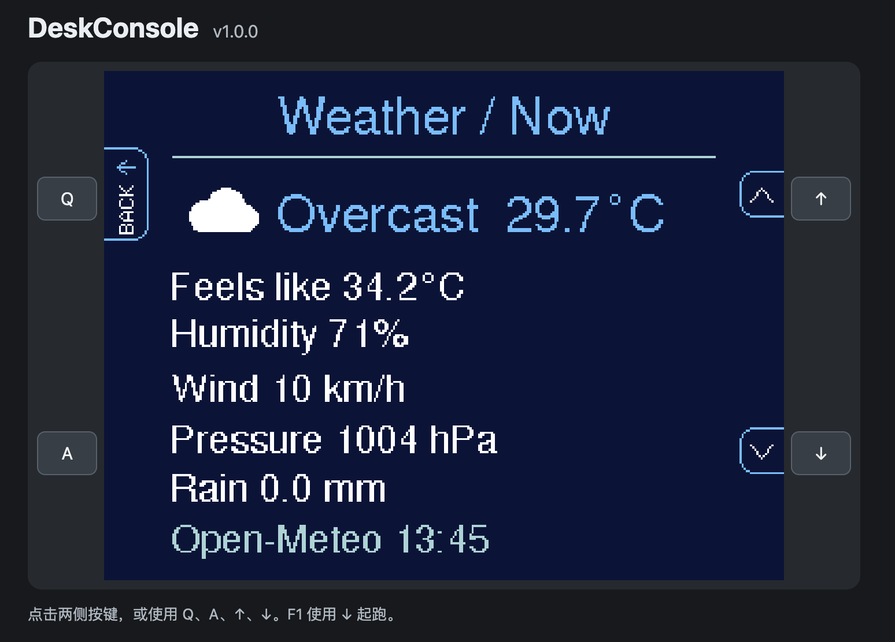
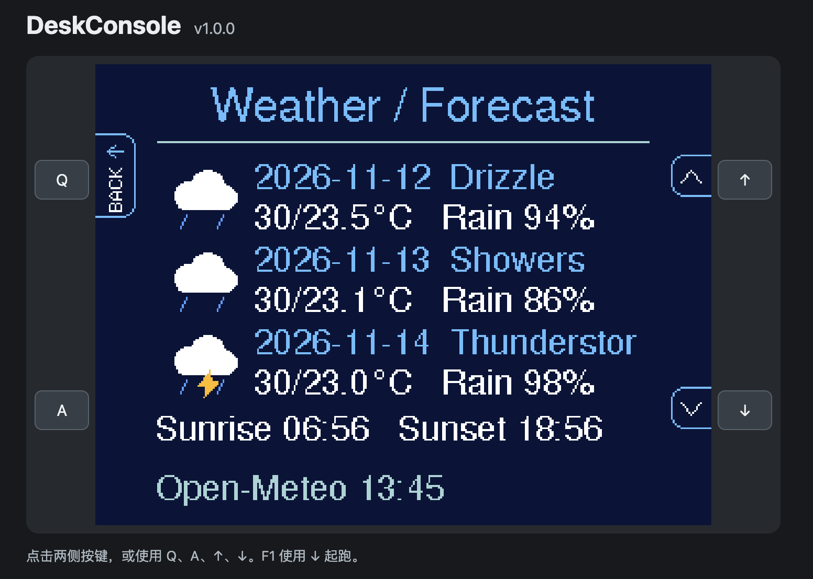
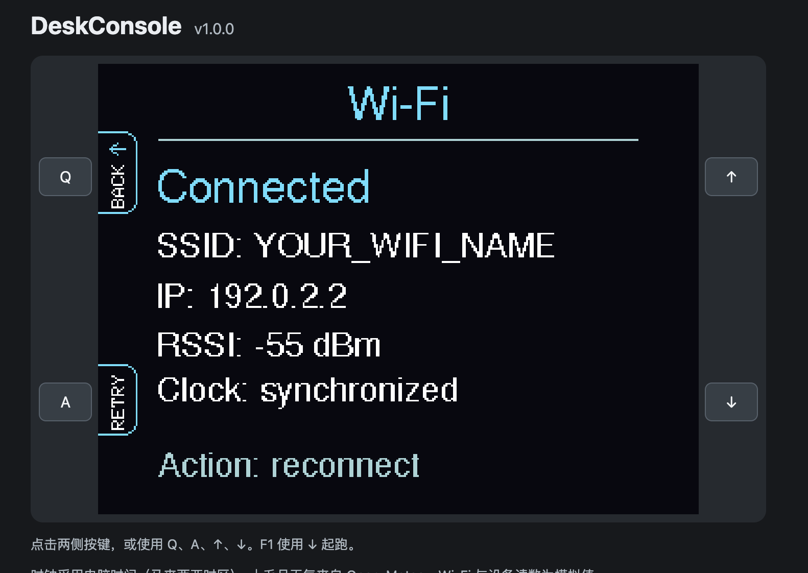
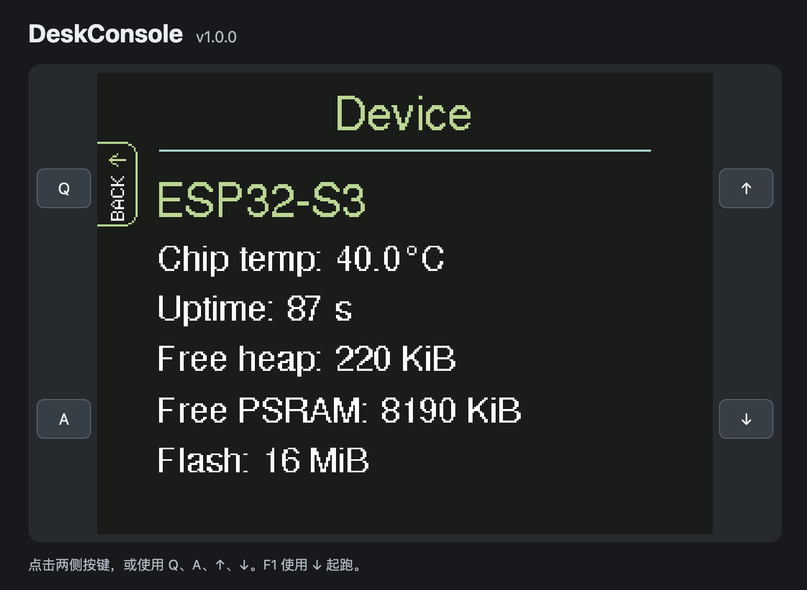
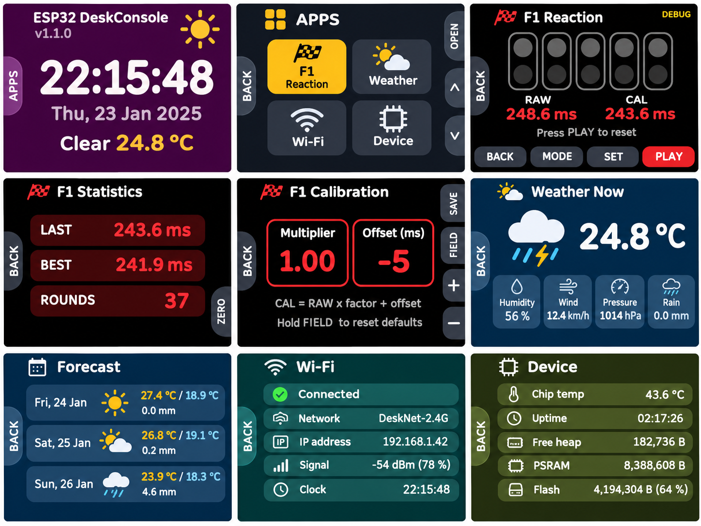
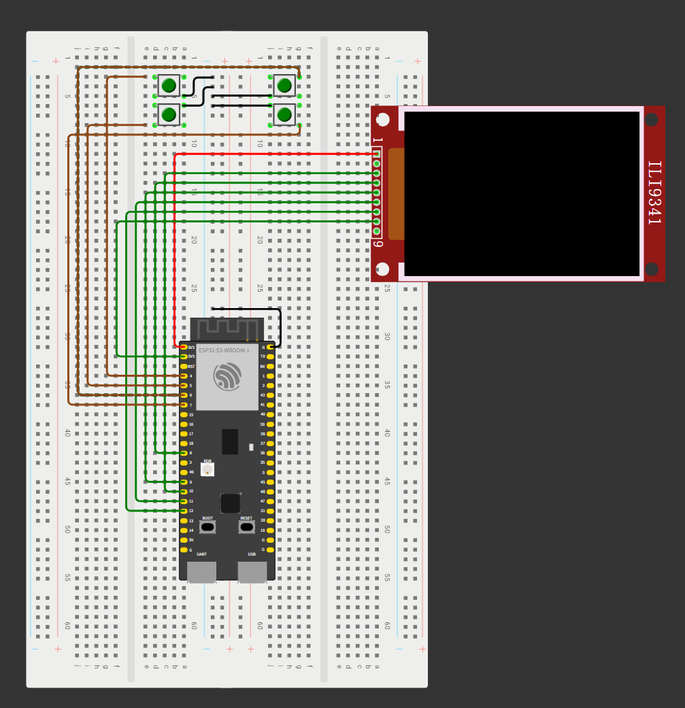

# ESP32 DeskConsole

English · [简体中文](README.zh-CN.md)

DeskConsole is a desktop console for the ESP32-S3 and a 320×240 ILI9341 SPI display. Its home screen shows the time, date, current weather and temperature for Semenyih, Malaysia. Four physical buttons open apps and navigate the interface.

- **F1 Reaction** — five two-row lamp housings, random lights-out, false starts, timeouts, Normal and Debug modes. The last result, personal best, and total completed rounds are saved in flash.
- **Weather** — current conditions and a three-day forecast from [Open-Meteo](https://open-meteo.com/en/docs).
- **Wi-Fi** — connection state, SSID, IP, signal strength and manual reconnect.
- **Bluetooth** — scans nearby BLE broadcasts. See the controls below.
- **Device** — temperature, memory and firmware usage, flash capacity and version.

Page changes animate the active button labels at the screen edges. Each app has its own accent color.

## Browser simulators

[Choose a firmware version online](https://uim-g.github.io/ESP32-DeskConsole/) to play all seven versions from v1.0.0 through v1.5.0. The matching [GitHub Releases](https://github.com/uim-g/ESP32-DeskConsole/releases) include standalone browser ZIPs.

[Play the latest browser version (v1.5.0)](https://uim-g.github.io/ESP32-DeskConsole/v1.5.0/)

Click the four side buttons or use **Q**, **A**, **↑**, and **↓**. In F1, use **↓** for PLAY. Scores are stored in the browser. Weather uses Open-Meteo and requires internet access. Wi-Fi and device readings are simulated.

| Home | Apps | F1 Reaction |
|---|---|---|
|  |  |  |

More v1.0.0 browser screenshots

| Current weather | Three-day forecast |
|---|---|
|  |  |

| Wi-Fi | Device |
|---|---|
|  |  |

## UI overview

The v1.1.0 concept sheet illustrates Home, Apps, F1, Statistics, Calibration, Weather Now, Forecast, Wi-Fi, and Device. This is a design illustration with sample values. The current firmware also has a Bluetooth app and updated Device meters. It uses a vertical app list, side labels aligned to physical buttons, vertically stacked RAW and CAL times, and forecast rain probability.

## Navigation and rendering

- **Home** shows time, date, current conditions and temperature. Press the upper-left button to open Apps.
- **Apps** uses the right buttons to move the selection and the lower-left button to open it. The rounded highlight eases between cards and inverts the text and icon it passes over. The card boundaries clip the moving highlight.
- **Weather** uses either right button to toggle between current conditions and the three-day forecast. Current conditions include humidity, wind, pressure, rain, sunrise and sunset. The forecast shows daily highs, lows, rain probability, and the Open-Meteo data time.
- **Wi-Fi** shows status, SSID, IP, RSSI and NTP readiness. Press the lower-left button to request reconnection.
- **Bluetooth** sits between Wi-Fi and Device. Press SCAN to scan for about four seconds. Hold SCAN for about 800 ms to toggle hiding unnamed devices and rescan. Results are sorted by RSSI, up to 24 devices, with three per page. Results can include the advertised name, address, RSSI and service UUID.
- **Device** shows chip temperature, uptime, firmware version and Flash capacity. Heap, PSRAM and Firmware cards display used / total with bars. Firmware capacity refers to the running APP partition. The thermometer uses green below 40°C, yellow from 40°C, and red from 50°C as visual cues.
- The App list scrolls and wraps in both directions. Hold either right button to repeat navigation in Apps, Weather, or Bluetooth.
- Page transitions slide out the old side labels, replace the page, then slide in the new labels. Label animation writes only the edge regions. The interface uses Nunito. Its license is included in [Nunito-OFL.txt](DeskConsole/Nunito-OFL.txt).

## F1 controls and calibration

- Press **PLAY** (lower right) to start. Five red lights illuminate in sequence. After a randomized wait, react when they go out. Press PLAY again after a result to reset the round. An early press is a false start and the reaction window is ten seconds.
- Press **MODE** (lower left) between rounds to toggle Normal and Debug. In Normal, **STATS** (upper right) shows the last outcome, best raw time and total rounds. Press **ZERO** twice to clear those records.
- In Debug, the result includes **RAW** and **CAL**. **SET** (upper right) opens calibration. Tap **FIELD** to select a parameter or hold it for about 800 ms to restore 1.00 and 0 ms. The right buttons adjust the multiplier by 0.01 or the offset by 1 ms. Holding either adjustment button repeats after about 420 ms. **SAVE** writes the settings to flash and returns.
- Calibration uses `CAL = max(0, RAW × multiplier + offset)`, with both times and the offset expressed in milliseconds. The multiplier range is 0.50–1.50 and the offset range is −500 to +500 ms. Adjusting calibration does not rewrite saved raw times.
- Completed reactions, false starts and timeouts count toward the total. Exiting mid-round does not.

## Idle light sleep and new records

With Auto sleep enabled, after the configured idle interval (three minutes by default), DeskConsole turns off the ILI9341 display output, stops Wi-Fi, and enters light sleep. Active F1 rounds stay awake. Press any button to wake to the same page, then release it before pressing again to perform an action. Wi-Fi reconnects and cached weather stays available. The backlight remains powered when LED is wired directly to 3V3.

F1 plays a brief fireworks animation when a valid raw reaction time beats the saved best. The first valid result establishes the baseline. Clearing statistics also resets that baseline.

## Settings

Open Settings after Device in the App list. Use the right buttons to select a row and EDIT to toggle it or enter value editing. While editing, Up increases and Down decreases. EDIT saves the value, and BACK cancels the edit. Confirmed changes are stored in flash and restored on startup.

- Auto sleep is on by default. Choose 1, 3, 5, or 10 minutes, with 3 minutes as the default.
- The onboard RGB status LED is on by default. Turn it off or adjust brightness from 1 to 8.

Settings selection and value changes use eased animations. Startup now draws Home before wireless setup, and the clock fields do not wait for NTP when drawing. The cause of lag on the first automatic boot after upload has not been confirmed.

## Serial Monitor

Use **115200 baud**. For native USB, enable **USB CDC On Boot** and re-upload if the sketch produces no serial output. Open the monitor before pressing RESET to capture startup messages. Logs include button presses, navigation, Wi-Fi and NTP status, weather updates, F1 lights and results, calibration edits and flash saves.

## Setup

1. In Arduino IDE 2, install **esp32 by Espressif Systems**. Select **ESP32S3 Dev Module** and your board's serial port. For N16R8, set Flash Size to 16 MB, choose a partition scheme with a 3 MiB APP slot (such as 16M Flash, 3MB APP/9.9MB FATFS), and enable OPI PSRAM if you want to use the onboard 8 MiB. BLE uses the ESP32 core library.
2. Install **Adafruit ILI9341** and its dependencies, plus **ArduinoJson 7**.
3. Open `DeskConsole/DeskConsole.ino`. In your local `Config.h`, fill in your 2.4 GHz Wi-Fi name and password. Keep placeholders in shared copies.
4. Wire the display and buttons as below, then compile and upload.

| ILI9341 | ESP32-S3 |
|---|---|
| VCC | 3V3 (with J1 bridged on the display module shown) |
| GND | GND |
| CS, RESET, DC | GPIO10, GPIO8, GPIO9 |
| MOSI, SCK | GPIO11, GPIO12 |
| LED (backlight) | 3V3 |
| SDO (MISO) | Leave disconnected |

Each button connects its GPIO to common GND when pressed. The firmware enables internal pull-ups.

| Button | Home / app navigation | F1 |
|---|---|---|
| Top left · GPIO4 | Apps / Back | Back |
| Bottom left · GPIO5 | Open / Action | Normal / Debug |
| Top right · GPIO6 | Up | Statistics |
| Bottom right · GPIO7 | Down | Play / React / Reset result |

F1 timing uses the TFT lights-out signal and includes hardware-dependent display and input latency. The prototype weather client skips HTTPS certificate verification. This release snapshot has not been recompiled or hardware-tested during packaging.

See [release history](CHANGELOG.md).

## Wiring diagram

The black wire immediately below the red VCC lead connects TFT GND to the same breadboard ground rail as the four buttons and ESP32-S3 GND. The diagram shows the display pins from VCC through SDO (MISO). On a module with extra touch pins, follow the printed labels and leave the touch pins disconnected for this build.

## Onboard RGB status LED

This build uses the onboard addressable LED on GPIO48, with each color channel adjustable up to 8 in Settings. Blue indicates startup, a reconnect request or a scan start. Green indicates Wi-Fi connected, BLE scan completed or a valid F1 time. Cyan confirms a saved calibration or cleared statistics. False starts flash red, timeouts and failed scans use amber, and a new F1 record cycles colors with the fireworks. The LED turns off during F1 countdown and reaction timing and before light sleep.

## License

The original DeskConsole source code is available under the [MIT License](LICENSE). Nunito font assets remain under the [SIL Open Font License 1.1](DeskConsole/Nunito-OFL.txt). Third-party libraries and weather data are subject to their respective terms.
