# ESP32 桌面控制台

[English](README.md) · 简体中文

DeskConsole 使用 ESP32-S3、320×240 ILI9341 SPI 屏幕和四个实体按键。桌面显示时间、日期，以及马来西亚士毛月的当前天气和气温。按键可以打开 App 和切换页面。

[在线试玩](https://uim-g.github.io/ESP32-DeskConsole/) · [动手复刻](#安装)

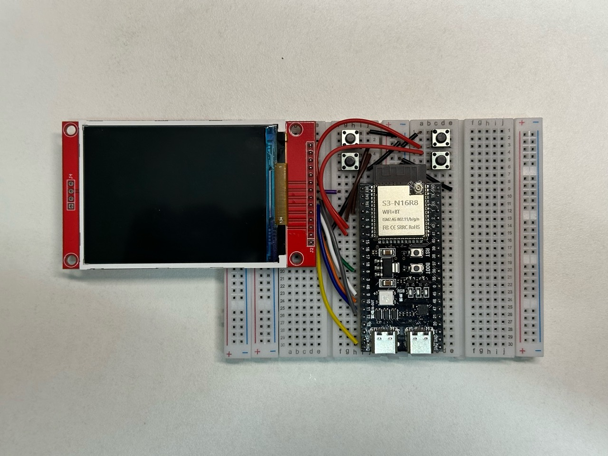

- **F1 Reaction**。五组双排灯箱、随机熄灯、抢跑、超时及 Normal / Debug 模式。上一局结果、个人最佳和总局数保存到闪存。
- **天气**。显示 [Open-Meteo](https://open-meteo.com/en/docs) 的当前天气和三天预报。
- **Wi-Fi**。查看连接状态、扫描网络、输入密码及管理已保存的网络。
- **Bluetooth**。扫描附近的 BLE 广播，操作见下方。
- **设备诊断**。查看温度、内存和固件用量、Flash 容量及版本。

切页时，侧边可用按键的标签会滑出和滑入。各 App 使用各自的主题色。

## v2.2.1 更新

- 天气实况和预报切换时，只更新副标题和内容。
- Wi-Fi 状态显示在标题栏，过长的 Wi-Fi 和蓝牙名称在各自区域内滚动。
- 已保存 Wi-Fi 列表满时，连接结果页会说明新网络未保存的原因。设备页底部居中，平时只更新变化的秒数数字。

[查看 v2.2.1 发布说明](https://github.com/uim-g/ESP32-DeskConsole/releases/tag/v2.2.1)。

## 安装

准备 ESP32-S3 N16R8 开发板、2.8 英寸 ILI9341 SPI 屏幕、四个常开轻触按键、面包板、跳线和 USB 数据线。

1. 在 Arduino IDE 2 中安装 **esp32 by Espressif Systems**，选择 **ESP32S3 Dev Module** 和开发板串口。N16R8 的 Flash Size 设为 16 MB，选择带 3 MiB APP 槽的分区方案（如 16M Flash，3MB APP/9.9MB FATFS）。若要使用板载 8 MiB PSRAM，可启用 OPI PSRAM。BLE 使用 ESP32 核心自带库。
2. 安装 **Adafruit ILI9341** 及其依赖，以及 **ArduinoJson 7**。
3. 到 [v2.2.1 发布页](https://github.com/uim-g/ESP32-DeskConsole/releases/tag/v2.2.1) 下载 **Source code (zip)**，解压后打开 `DeskConsole/DeskConsole.ino`。
4. 拔掉 USB 后按下表接线，再接回 USB、选择串口并上传。屏幕进入桌面后，按左上键打开应用菜单，再选择 Wi-Fi 联网。

Wi-Fi 支持 2.4 GHz 开放网络和个人网络，最多保存八个网络。无线功能开启时，开机会尝试最近连接成功的已保存网络。连接失败时，可以重新扫描或手动选择其他已保存网络。八条记录存满后，新网络仍能连接。删除一条旧记录并重新连接后，才能保存新网络。暂不支持 WPA-Enterprise 校园网。密码保存在 NVS，项目未配置加密存储。

| ILI9341 | ESP32-S3 |
|---|---|
| VCC | 3V3（图中对应的屏幕模块需短接 J1） |
| GND | GND |
| CS、RESET、DC | GPIO10、GPIO8、GPIO9 |
| MOSI、SCK | GPIO11、GPIO12 |
| LED（背光） | 3V3 |
| SDO（MISO） | 留空 |

每个按钮接相应 GPIO 和公共 GND。程序启用内部上拉。

| 按键 | 桌面和 App 导航 | F1 |
|---|---|---|
| 左上 GPIO4 | App 列表／返回 | 返回 |
| 左下 GPIO5 | 打开／执行 | Normal / Debug |
| 右上 GPIO6 | 向上 | 统计 |
| 右下 GPIO7 | 向下 | 开始／反应／清除本局 |

F1 以 TFT 熄灯为信号，成绩会受显示和输入延迟影响。天气客户端目前跳过 HTTPS 证书校验。v2.2.0 固件已在 ESP32-S3 N16R8 原型上实测，v2.2.1 已通过网页版模拟测试。

参见[版本记录](CHANGELOG.md)。

### 接线图

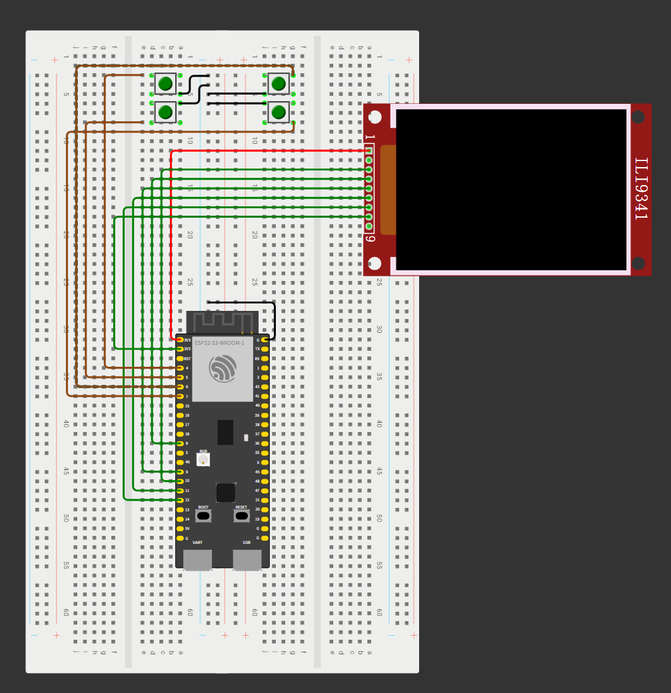

红色 VCC 线下方的黑线把屏幕 GND 接到公共地排，与四个按键及 ESP32-S3 共地。图中画的是 VCC 到 SDO（MISO）这组屏幕引脚。若实物还有触摸排针，请按模块丝印接线，触摸引脚留空。

## 网页模拟器

[打开在线版本选择页](https://uim-g.github.io/ESP32-DeskConsole/)，试玩 v1.0.0 至 v2.2.1 的全部十一个版本。各版本的 [GitHub Release](https://github.com/uim-g/ESP32-DeskConsole/releases) 也提供网页 ZIP 下载。

[在线试玩最新版（v2.2.1）](https://uim-g.github.io/ESP32-DeskConsole/v2.2.1/)

[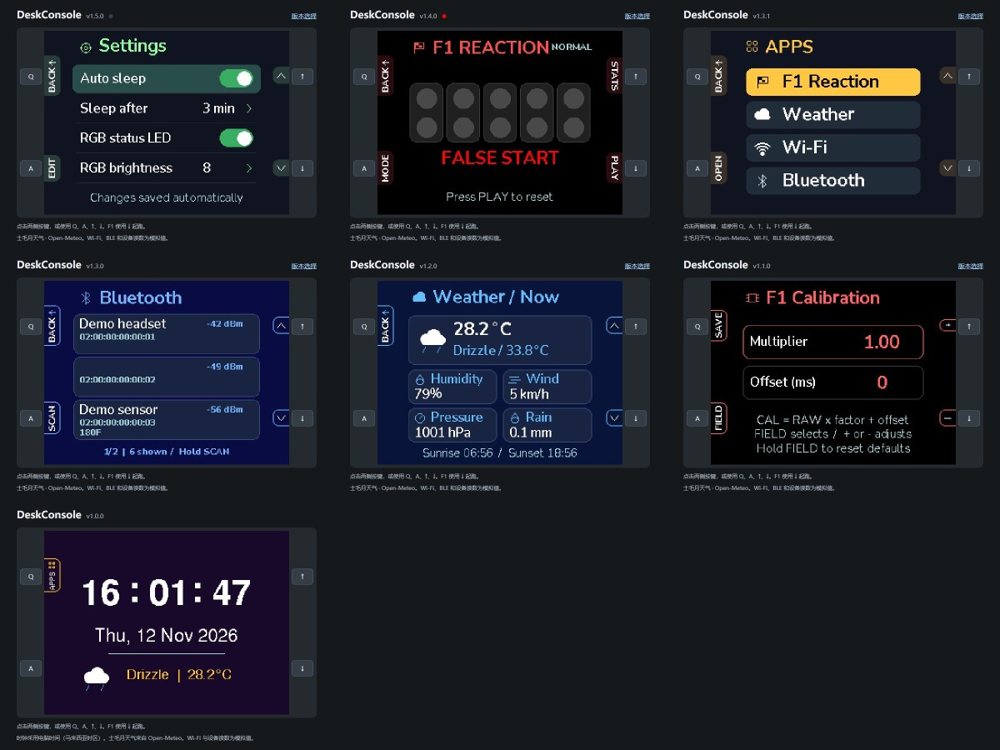](CHANGELOG.md)

点击两侧的四个按钮，或使用 **Q**、**A**、**↑** 和 **↓**。F1 中用 **↓** 开始和起跑。成绩保存在浏览器中。实时天气需要联网访问 Open-Meteo，Wi-Fi 和设备读数为模拟值。

| 桌面 | App 菜单 | F1 Reaction |
|---|---|---|
| 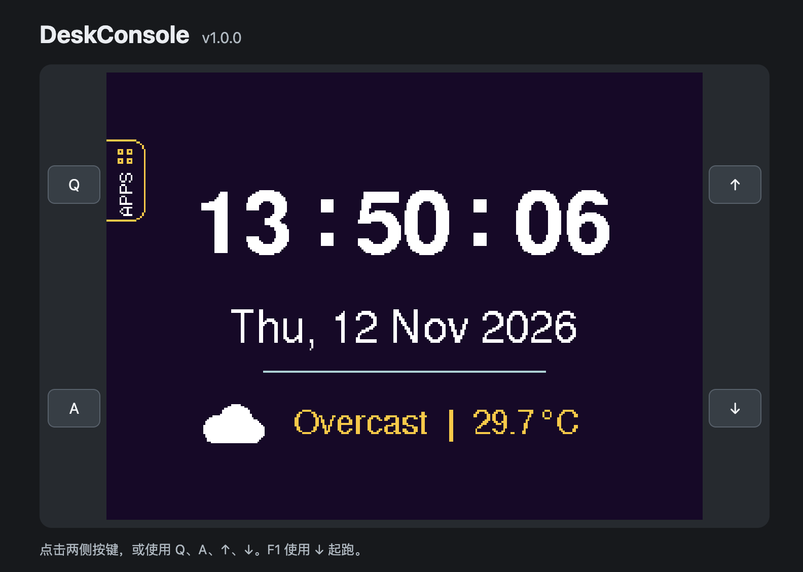 | 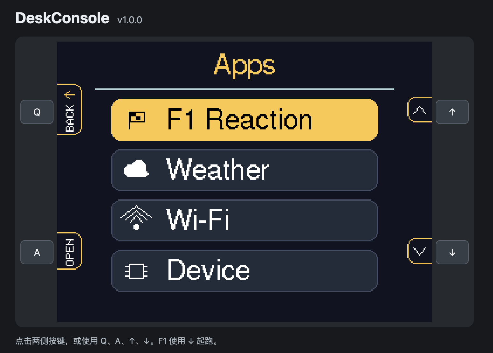 | 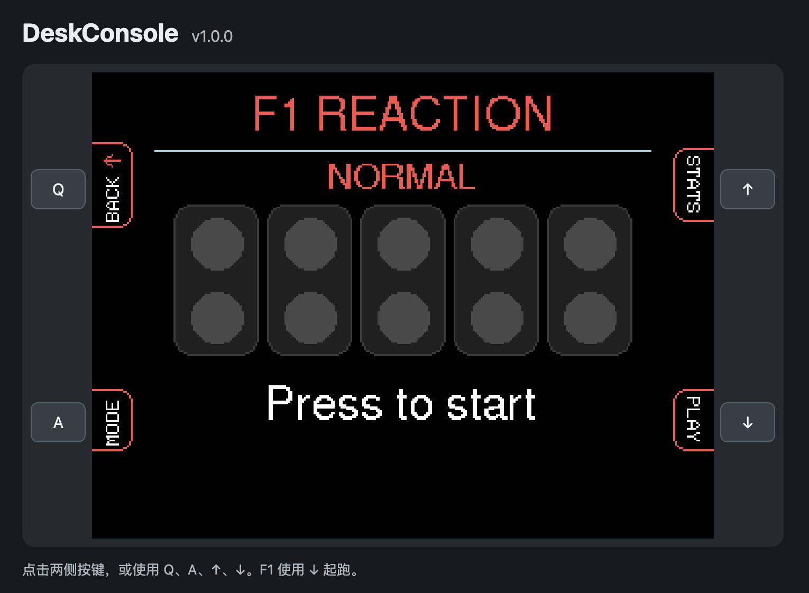 |

更多 v1.0.0 网页截图

| 当前天气 | 三日预报 |
|---|---|
| 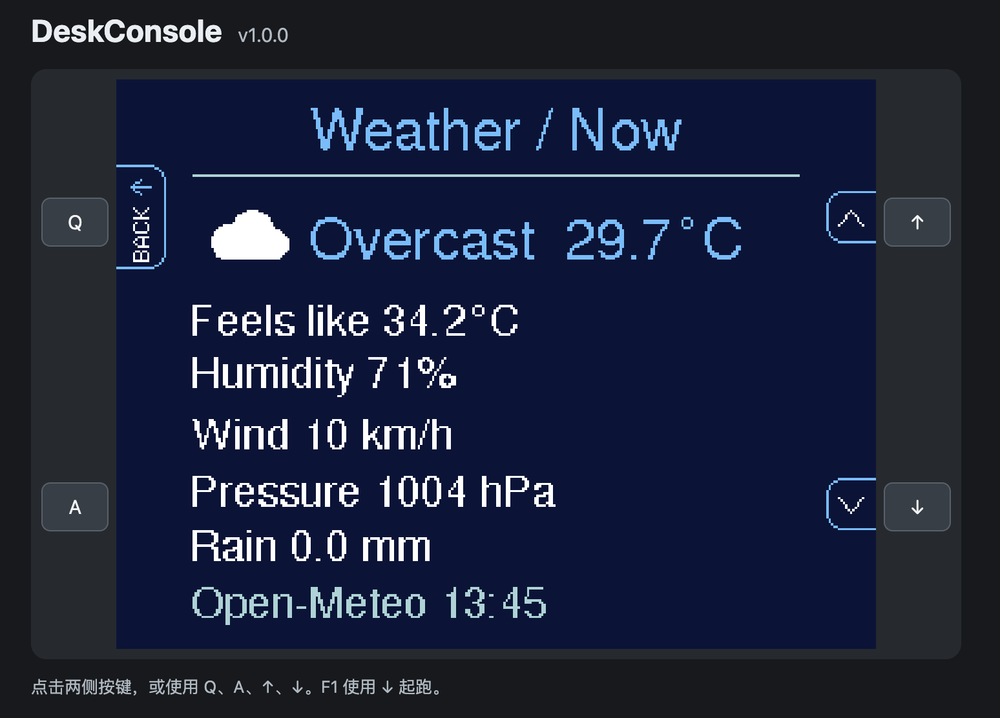 | 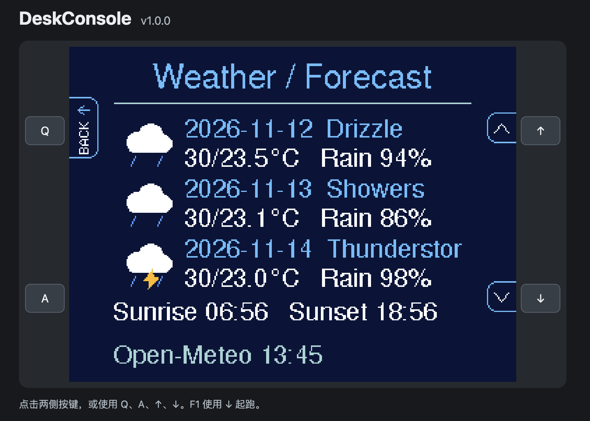 |

| Wi-Fi | 设备诊断 |
|---|---|
| 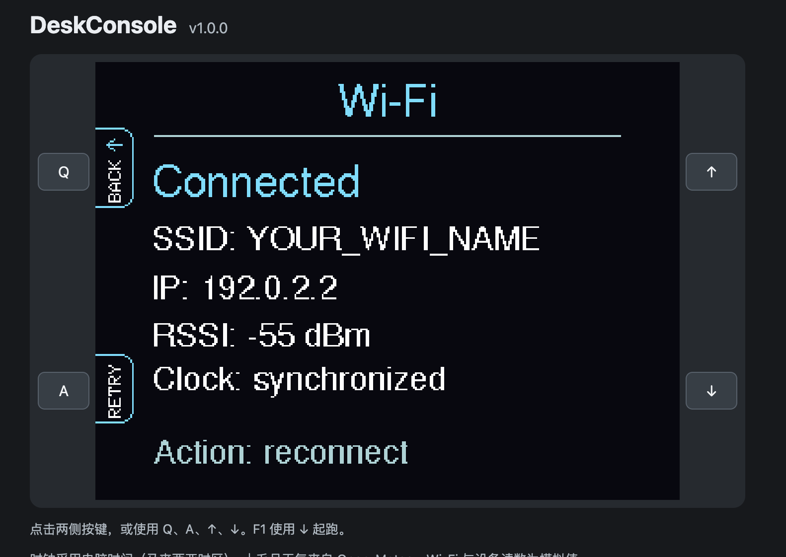 | 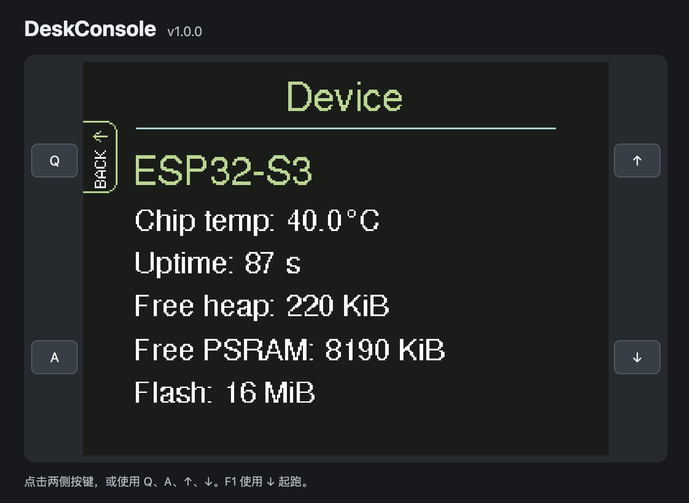 |

## 界面预览

**仅供设计参考。** 这张图是界面设计稿。[各版本的实际网页截图](CHANGELOG.md)见版本记录。

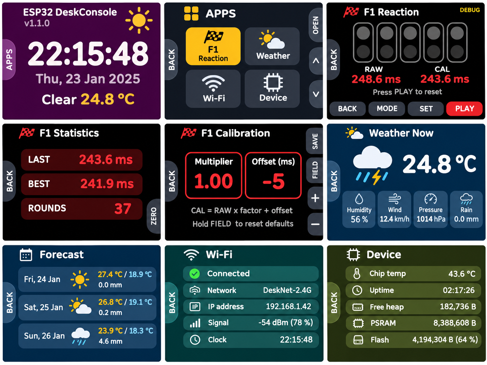

v1.1.0 的九格设计稿依次展示桌面、App 菜单、F1、统计、补偿设置、当前天气、预报、Wi-Fi 和设备诊断。当前固件还新增了 Bluetooth 和新版 Device 用量条。实际固件使用纵向 App 列表、对应实体键的侧边提示、上下排列的 RAW 和 CAL，以及预报降雨概率。

## 导航和绘制

- **桌面**显示时间、日期、天气和气温。按左上键打开 App 菜单。
- **App 菜单**用右侧两键选择，左下键打开。圆角高亮在卡片之间缓动，扫过的文字和图标反色，高亮限制在卡片范围内。
- **天气**用任一右侧键切换当前天气和三天预报。当前页显示湿度、风速、气压、降雨和当天的日出日落。预报页显示每日高低温、降雨概率和 Open-Meteo 数据时间。
- **Wi-Fi**显示连接状态、SSID、IP、RSSI 和 NTP 校时状态。第一行控制 Wi-Fi 开关。扫描后可选择网络连接。输入密码时长按 SELECT 切换字符组。在已保存列表中，短按左下键连接，长按删除选中的网络。
- **Bluetooth** 位于 Wi-Fi 和 Device 之间。短按 SCAN 扫描约 4 秒，长按约 800 ms 切换是否隐藏无名称设备并重新扫描。结果按 RSSI 排序，最多保留 24 条，每页三条。显示广播名称、地址、RSSI，以及有提供的服务 UUID。
- **设备诊断**显示芯片温度、运行时长、固件版本和 Flash 总容量。运行时长只重绘变化的数字。Heap、PSRAM 和 Firmware 显示「已用 / 总量」及用量条。Firmware 总量对应运行中的 APP 分区。温度提示低于 40°C 为绿，40°C 起为黄，50°C 起为红。
- App 菜单双向循环滚动。App 菜单、天气和蓝牙页支持长按右侧两键连续翻动。
- 换页时旧标签先滑出，正文换页后新标签再滑入。标签动画只更新屏幕边缘。界面使用 Nunito 字体，许可证见 [Nunito-OFL.txt](DeskConsole/Nunito-OFL.txt)。

## F1 按键和补偿

- 右下 **PLAY** 开始一局。五盏红灯依次点亮，随机等待后熄灭，立即按 PLAY 记录反应。出结果后再按 PLAY 清除本局。提前按下算抢跑，反应时限为 10 秒。
- 局间按左下 **MODE** 切换 Normal 和 Debug。Normal 下，右上 **STATS** 查看上一局、最快原始成绩和总局数，左下 **ZERO** 连按两次可归零。
- Debug 显示 **RAW** 和 **CAL**。右上 **SET** 进入补偿设置，短按 **FIELD** 选参数，按住约 800 ms 恢复 1.00 和 0 ms。右侧两键每次调整 0.01 倍或 1 ms，按住约 420 ms 后开始连调。左上 **SAVE** 写入闪存并返回。
- 公式为 `CAL = max(0, RAW × 系数 + 偏移)`，时间和偏移均以毫秒计。系数范围 0.50–1.50，偏移范围 −500 到 +500 ms。调整补偿后，已保存的原始成绩仍可比较。
- 有效反应、抢跑和超时都计入总局数，中途退出不计。

## 闲置轻度休眠和破纪录动画

自动休眠开启且达到设定的无操作时长（默认 3 分钟）后，程序关闭 ILI9341 显示输出、停止 Wi-Fi，并进入轻度休眠。F1 进行中保持唤醒。任意实体键可唤醒并回到原页面，松开后再按才执行操作。Wi-Fi 自动重连，天气缓存仍可用。如果屏幕 LED 直连 3V3，背光仍会亮。

F1 刷新已保存的最快原始成绩时会播放短暂的烟花动画。第一笔有效成绩建立基准，归零统计时也会重置烟花的比较基准。

## 设置

Settings 位于 App 列表中 Device 后面。右侧键选择项目，EDIT 切换开关或进入数值编辑。编辑时上键增加、下键减少，EDIT 保存，BACK 取消编辑。确认后的设置写入闪存，开机时自动恢复。

- 自动休眠默认开启，可选 1、3、5 或 10 分钟，默认 3 分钟。
- 板载 RGB 状态灯默认开启，可以关闭或把亮度调到 1–8。

设置选中框和数值变化都有缓动动画。启动时先显示桌面，再初始化网络，绘制时钟时直接读取系统时间。上传后第一次自动启动卡顿的原因尚未确认。

## 串口监视器

波特率为 **115200**。通过原生 USB 连接时，若串口没有输出，可启用 **USB CDC On Boot** 后重新上传。先打开监视器再按 RESET，可以看到启动日志。日志包括按键、导航、Wi-Fi 和 NTP 状态、天气更新、F1 灯号与成绩、补偿调整和闪存保存结果。

## 板载 RGB 状态灯

程序使用 GPIO48 控制板载 RGB，每个颜色通道可在设置中调节，最高为 8。蓝色提示开机、重连请求或开始扫描，绿色提示 Wi-Fi 连上、蓝牙扫描完成或取得有效成绩，青色表示保存补偿或统计归零成功。抢跑红闪，超时和扫描失败用琥珀色，破纪录时配合烟花彩闪。F1 倒数、反应计时和轻睡前会关灯。

## 许可证

DeskConsole 原创源码采用 [MIT 许可证](LICENSE)。Nunito 字体资源继续遵循 [SIL 开源字体许可证 1.1](DeskConsole/Nunito-OFL.txt)。第三方库和天气数据遵循各自的条款。
