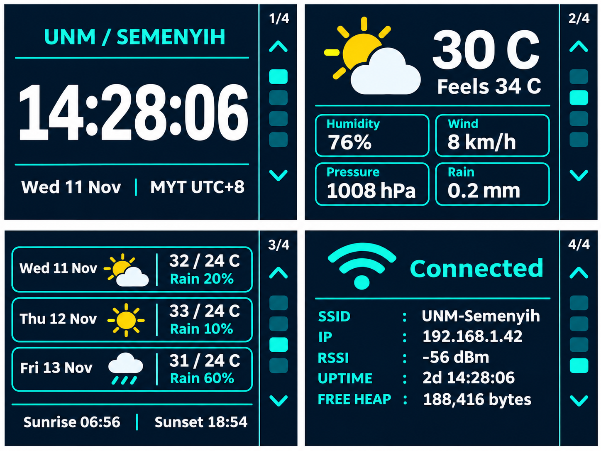
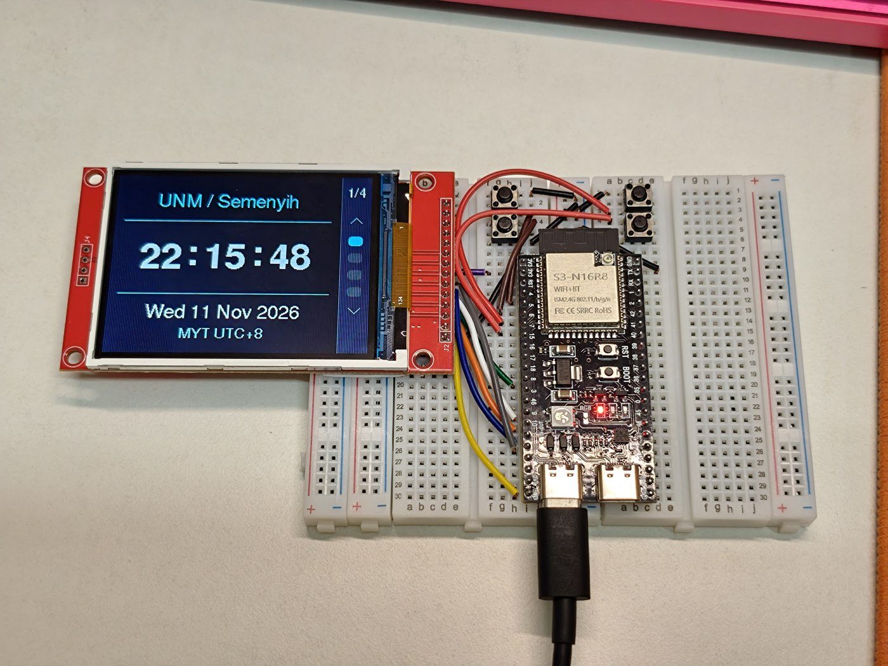
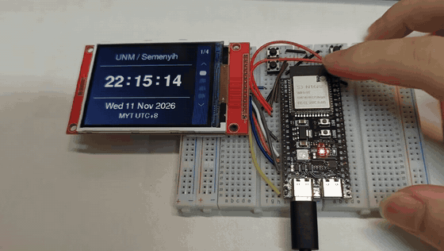
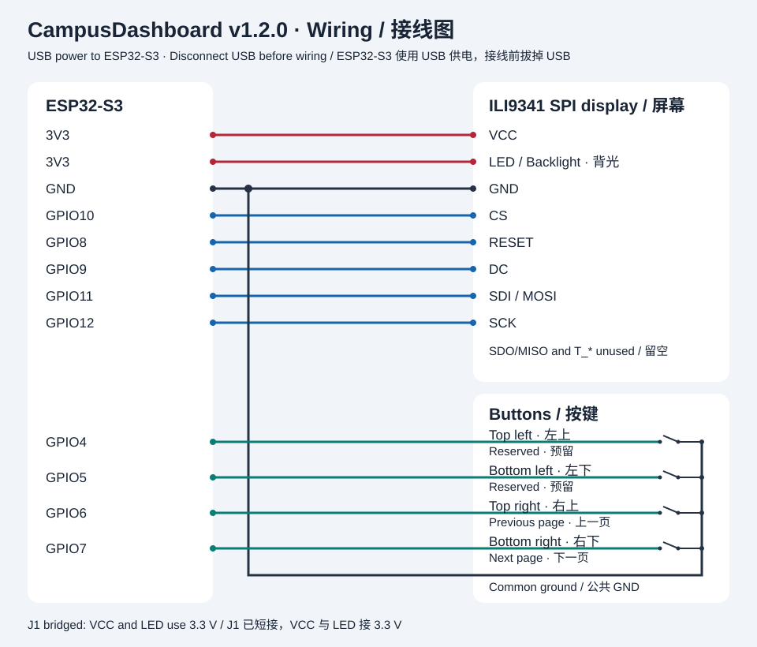
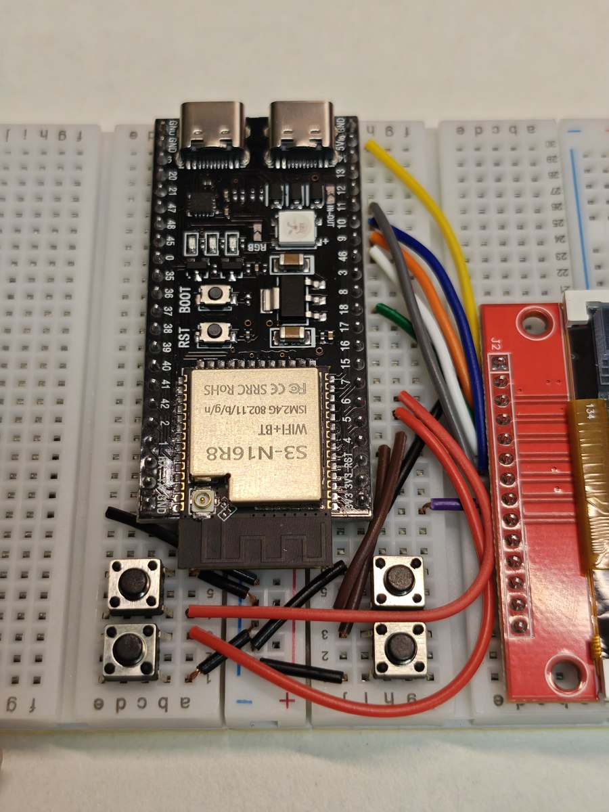

# ESP32 校园仪表盘

这是 DeskConsole 的独立前置实验。在 Arduino IDE 中打开 [CampusDashboard/CampusDashboard.ino](CampusDashboard/CampusDashboard.ino)。导入自 [ESP32-CampusDashboard @ d1aecdf](https://github.com/uim-g/ESP32-CampusDashboard/commit/d1aecdf)。[原仓库](https://github.com/uim-g/ESP32-CampusDashboard) · [历史发布](https://github.com/uim-g/ESP32-CampusDashboard/releases)。

[English](README.md) · 简体中文

用 ESP32-S3 和 2.8 英寸 ILI9341 SPI 屏幕显示马来西亚诺丁汉大学士毛月校区的时间、天气和设备状态。

上图是 UI 设计稿，数值为示例。实际固件使用 Adafruit GFX 绘制。

## 实物原型

## 开始使用

1. 在 Arduino IDE 2 的开发板管理器安装 `esp32 by Espressif Systems`，选择 `ESP32S3 Dev Module` 和实际串口。N16R8 使用 16 MB Flash。曾在 Arduino-ESP32 3.3.12 环境中烧录项目原型。
2. 在库管理器安装 Adafruit ILI9341 及其依赖，以及 ArduinoJson 7。
3. 打开 `CampusDashboard/CampusDashboard.ino`，在本地 `Config.h` 填入 Wi-Fi 名称和密码。提交代码前恢复占位符。
4. 编译上传。接线和各版本区别见 [开发日志](docs/LOGBOOK.md)。

右上 GPIO6 上翻，右下 GPIO7 下翻，首尾双向循环。早期版本使用 GPIO4–7 直达四页。

天气使用 [Open-Meteo](https://open-meteo.com/en/docs) 的室外模型数据。时钟通过 NTP 校时，显示 MYT（UTC+8）。固件当前以原型设置跳过 HTTPS 服务器证书校验。

## 接线

四个按钮各接一个 GPIO，另一端都接公共 GND。左上 GPIO4、左下 GPIO5 接好后留作后续使用。v1.2.0 使用右上 GPIO6 和右下 GPIO7 翻页，并启用这两路的内部上拉。屏幕 J1 已短接时，VCC 和 LED 都接 3.3 V。

